# 🚀 RETAIN-AI : AI-Powered Customer Intelligence & Retention Analytics Platform

### CLV-Driven Customer Churn Prediction & Retention Intelligence Platform

An end-to-end AI-powered customer analytics platform that combines Customer Lifetime Value (CLV) analysis, churn prediction, customer segmentation, explainable AI, batch dataset intelligence, and executive reporting into a unified decision-support system.


---

## 📌 Overview

RetainAI is a production-style customer intelligence platform developed to help businesses identify customers at risk of churn, analyze Customer Lifetime Value (CLV), explore customer segments, and support data-driven retention strategies. The platform combines statistical customer value modeling with machine learning-based churn prediction to provide actionable business insights.

The platform unites machine learning inference with interactive analytics through a Streamlit frontend, a FastAPI backend, and an analytical data store, providing a modular and scalable architecture suitable for production deployment, portfolio demonstrations, and enterprise decision-making.

---

# ✨ Key Features

## 📊 Executive Dashboard
- **Dual-Tier KPI Architecture:**
  - **Global Database KPIs:** High-level enterprise baselines across the customer base (Total Revenue Base, Active Customers, Revenue at Risk, High Risk Profiles).
  - **Scenario Portfolio KPIs:** Dynamic forecasts (Projected 90-Day Revenue, Secured Revenue, Revenue at Risk, High-Risk Whales) that respond in real time to custom simulation parameters.
- **Interactive Scenario Simulator:** Synchronized sidebar sliders and numeric controls to adjust high-risk churn probability thresholds and CLV cutoffs.
- **Customer Map Visualization:** Interactive risk-vs-value scatter matrix with logarithmic CLV scaling powered by Plotly.
- **High-Value Interventions:** Actionable intervention table highlighting top accounts requiring immediate retention measures.

---

## 👥 Customer Intelligence
- **Search & Discovery:** Instant customer lookup by Customer ID and advanced filtering by country, segment, and churn status.
- **Customer 360 Profile:** Comprehensive single-customer view featuring business metrics, risk rating, priority level, and AI-recommended retention actions.
- **Order History Explorer:** Transaction-level invoice summary with one-click customer receipt CSV export.
- **Dynamic Scenario Filtering:** Real-time cohort re-segmentation based on custom risk and monetary thresholds.

---

## 🎯 Segmentation Analytics
- **Strategic RFM Matrix:** Classifies customer portfolio into four distinct retention quadrants:
  - 🚨 **High-Risk Whales:** High CLV, High Churn (immediate VIP concierge outreach).
  - 🏆 **Loyal Champions:** High CLV, Low Churn (loyalty rewards and upsell opportunities).
  - ⚠️ **At-Risk Regulars:** Low CLV, High Churn (automated win-back drip campaigns).
  - 🛡️ **Safe Regulars:** Low CLV, Low Churn (standard engagement and monitoring).
- **Interactive Matrix Controls:** Real-time quadrant boundary adjustment via synchronized sliders and numerical inputs.
- **Revenue Mix & Distribution:** Segment-wise revenue share donut charts and customer distribution analytics.
- **Prescriptive Strategy Cards:** Tactical business playbooks and recommendations for each segment.

---

## 🤖 Prediction Center
Offers three dedicated operational modes for real-time and batch customer evaluation:

1. **Existing Customer Mode:**
   - Search any existing customer by ID to auto-populate their historical metrics.
   - Generates real-time churn probability, risk classification, and retention strategies.

2. **New / Hypothetical Customer Simulation:**
   - Interactive 7-feature simulation form (Recency, Frequency, Monetary, Tenure, Purchase Velocity, Average Order Value, Item Diversity).
   - Dual slider and manual numeric inputs for granular what-if analysis.

3. **Dataset Intelligence (Batch Processing Workspace):**
   - **Batch File Ingestion:** Ingest raw transaction datasets (`.csv`, `.xlsx`, `.xls`) matching standard retail schemas.
   - **In-Memory Analytical Pipeline:** Runs end-to-end data cleaning, RFM aggregation, behavioral feature engineering, CLV estimation (BG/NBD + Gamma-Gamma), and churn inference without modifying persistent databases.
   - **Batch Dashboard:** Cohort KPI summaries, churn risk distribution charts, and quadrant breakdowns.
   - **Customer Directory & 360:** Paginated customer directory with multi-column filtering, sorting, **📥 Download Filtered Customers CSV**, and a deep-dive Customer 360 profile featuring **7 individual behavioral metric cards** (Recency, Frequency, Monetary, Tenure, Velocity, AOV, Item Diversity).
   - **Dynamic Quadrant Simulator:** Interactive scenario testing for uploaded cohorts with scatter plots, revenue mix charts, and cohort tables.
   - **Batch Export Center:** One-click CSV exports for complete predictions, executive summaries, high-risk cohorts, and segment summaries.

---

## 🧠 Model Insights (Explainable AI)
- **Comprehensive Evaluation Metrics:** Displays model Accuracy, Precision, Recall, F1 Score, and ROC-AUC.
- **ROC Curve & Confusion Matrix:** Interactive diagnostic plots evaluating classification trade-offs and decision boundaries.
- **Feature Importance Analysis:** Ranked feature impact highlighting the primary behavioral drivers of churn.
- **Business Interpretation:** Plain-language explanations of model weights to support stakeholder trust.

---

## 📄 Reports & Export
- **Executive Summary:** Generates structured executive business summaries with key financial exposure metrics.
- **High-Speed CSV Exports:** One-click downloads for full customer records, high-risk intervention lists, and segment summaries.
- **Session History Export:** Download predictions performed during the active user session.

---

## ⚙️ Modular Architecture
- Decoupled Streamlit frontend and FastAPI REST backend.
- Pure RESTful JSON and streaming file communication.
- Self-contained SQLite analytical database.
- Clean separation of API, services, ML loaders, data pipelines, and schemas.

---

# 🏗️ System Architecture

RetainAI follows a modular, decoupled architecture that isolates the user interface, business services, analytical pipelines, and data storage:

```text
                           ┌─────────────────────────────────────────┐
                           │            Streamlit Frontend           │
                           │─────────────────────────────────────────│
                           │ • Executive Dashboard                   │
                           │ • Segmentation Analytics                │
                           │ • Customer Intelligence                 │
                           │ • Prediction Center (Single & Batch DI) │
                           │ • Model Insights (Explainable AI)       │
                           │ • Reports & Export                      │
                           └────────────────────┬────────────────────┘
                                                │
                                      REST API Requests (JSON / Files)
                                                │
                                                ▼
                           ┌─────────────────────────────────────────┐
                           │             FastAPI Backend             │
                           │─────────────────────────────────────────│
                           │ • Dashboard API     • Customer API      │
                           │ • Prediction API    • Dataset API (DI)  │
                           │ • Model API         • Reports API       │
                           └────────┬───────────────────────┬────────┘
                                    │                       │
           ┌────────────────────────┴──────┐                │
           ▼                               ▼                ▼
┌──────────────────────┐       ┌──────────────────────┐  ┌────────────────────────┐
│  In-Memory Pipeline  │       │   Machine Learning   │  │    SQLite Database     │
│──────────────────────│       │──────────────────────│  │────────────────────────│
│ • Data Cleaning      │       │ • Churn Prediction   │  │ • Customers Table      │
│ • RFM Transformation │       │   (Logistic Regress) │  │ • Transactions Table   │
│ • Feature Extraction │       │ • CLV Estimation     │  │ • Predictions History  │
│ • Dynamic Batch Runs │       │   (BG/NBD + GG)      │  │ • Model Metadata       │
└──────────────────────┘       └──────────────────────┘  └────────────────────────┘
```

### Architecture Highlights

- **Presentation Layer:** Streamlit delivers responsive, state-synchronized interfaces with dark-mode styling and Plotly visualizations.
- **Service & API Layer:** FastAPI exposes validated REST endpoints with Pydantic schemas, managing caching, filtering, and business logic.
- **In-Memory Pipeline Engine:** Executes multi-stage data processing and ML inference dynamically during batch uploads without database mutation.
- **Machine Learning Layer:** Serialized Scikit-learn and Lifetimes models provide real-time churn scores and 90-day CLV projections.
- **Persistence Layer:** SQLite stores core customer records, historical transactions, predictions, and model evaluation metadata.

---

# 📸 Project Screenshots

The following screenshots showcase the core modules of the RetainAI platform:

## 📊 Executive Dashboard
> Dual-tier enterprise KPIs, risk-vs-value customer map, and immediate intervention lists.

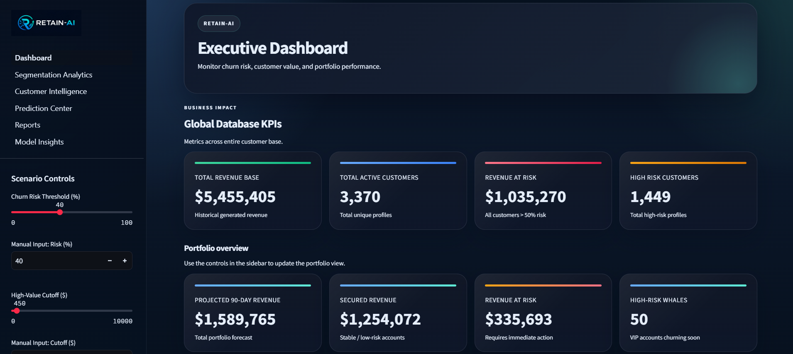
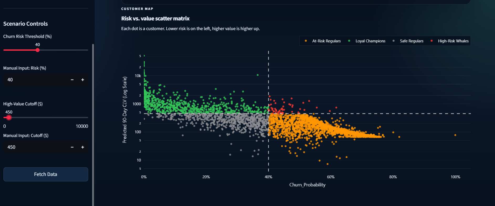

---

## 🎯 Segmentation Analytics
> Strategic RFM quadrant mapping, scenario threshold sliders, and segment revenue share analysis.

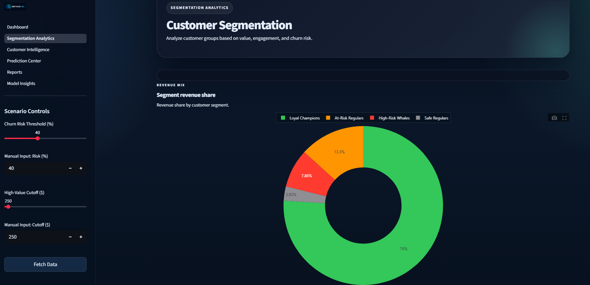

---

## 👥 Customer Intelligence
> Multi-criteria search, Customer 360 profiles, AI retention recommendations, and transaction history.

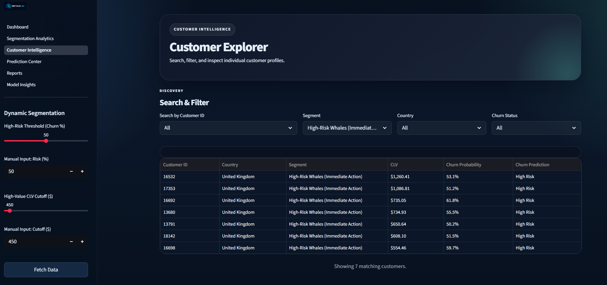
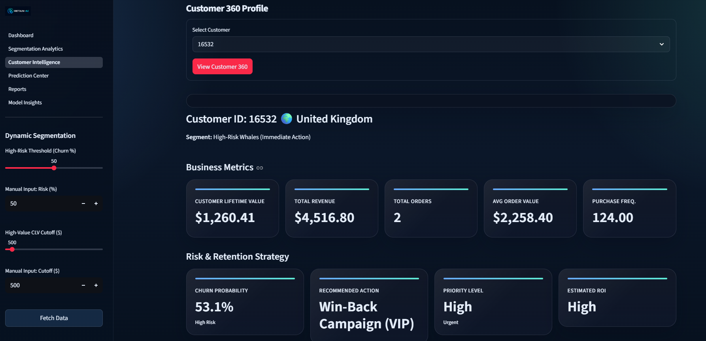

---

## 🤖 Prediction Center & Dataset Intelligence
> Single-customer predictions, hypothetical what-if simulations, and batch dataset intelligence workspace.

> Existing Customer
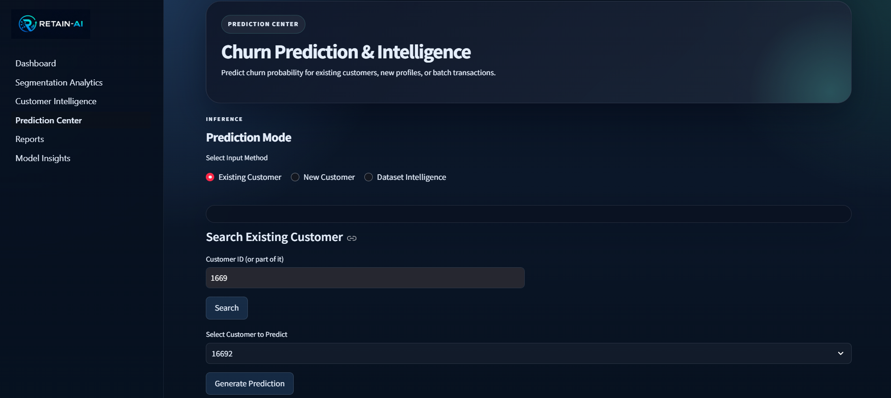
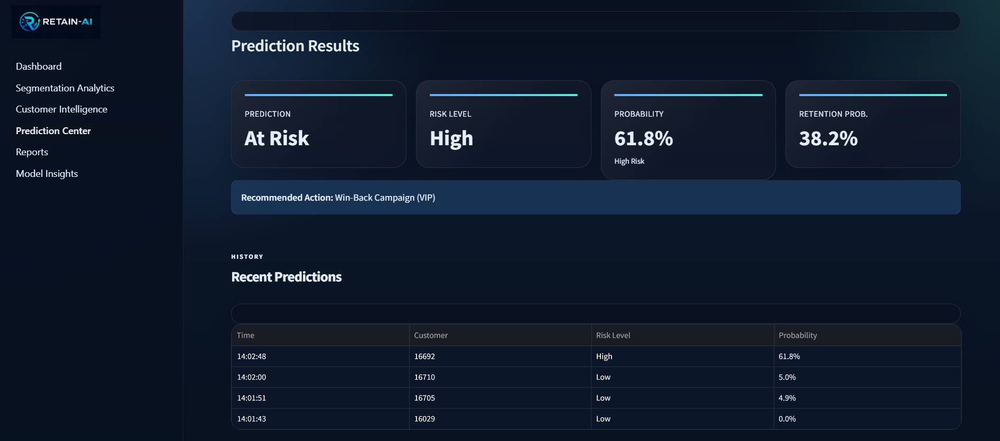

> New Customer
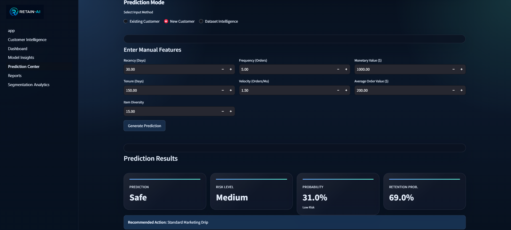

> Customer Intelligence (Batch)
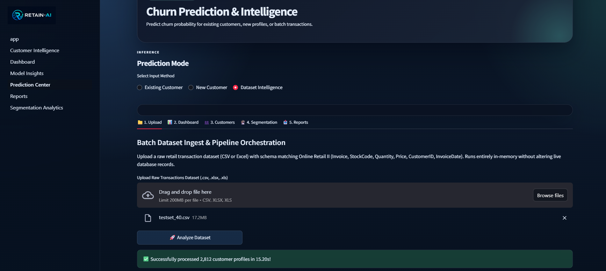
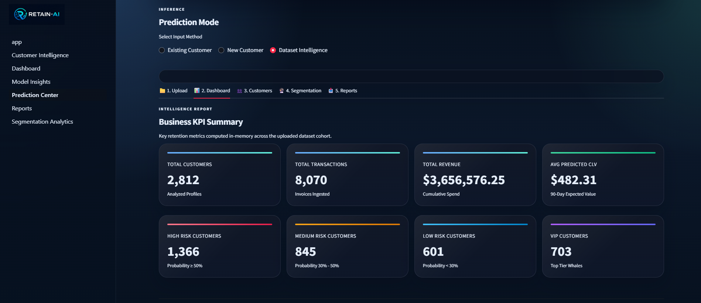
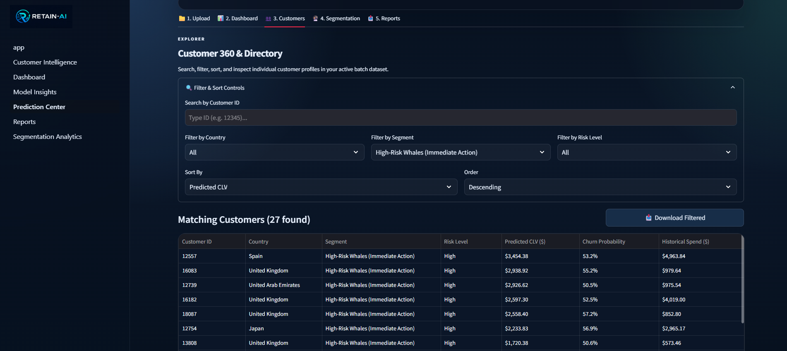
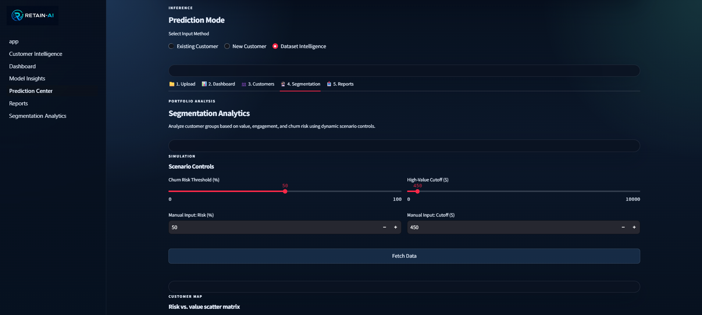
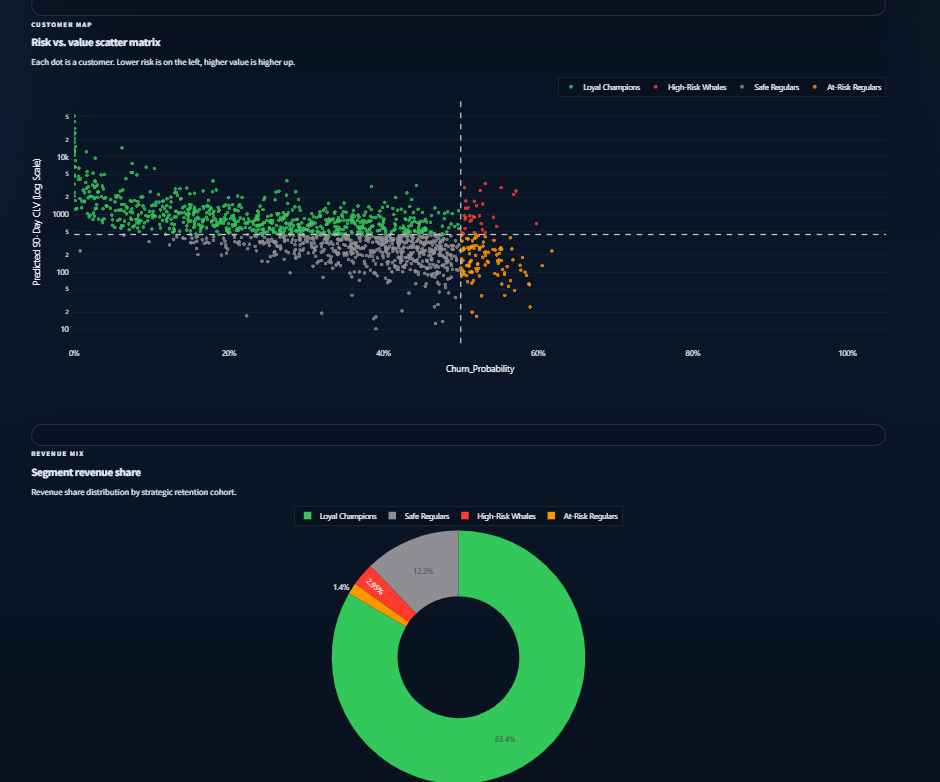
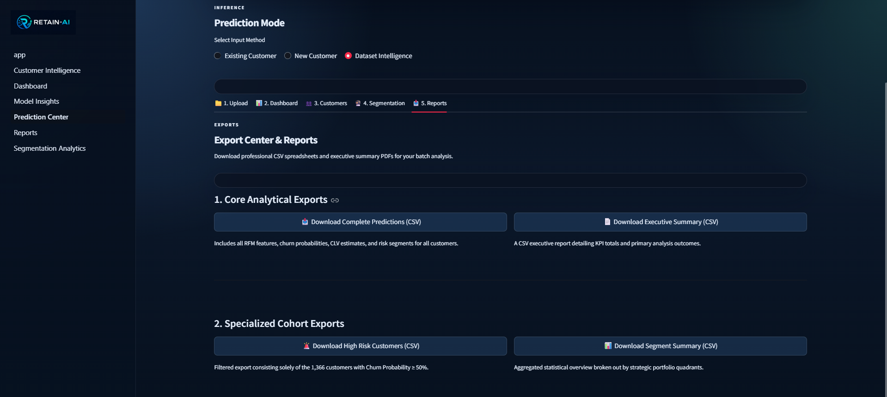
---

## 📄 Reports & Export
> High-speed CSV exports, executive summaries, and session prediction downloads.

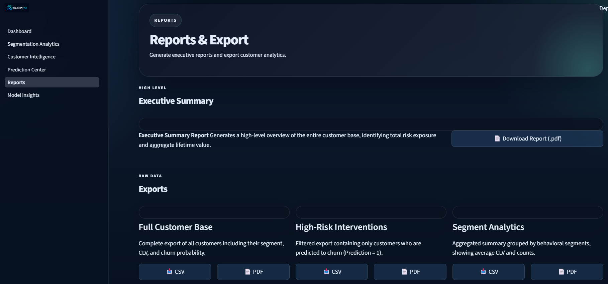

---

## 🧠 Model Insights
> Performance metrics, ROC curve, Confusion Matrix, and feature importance rankings.

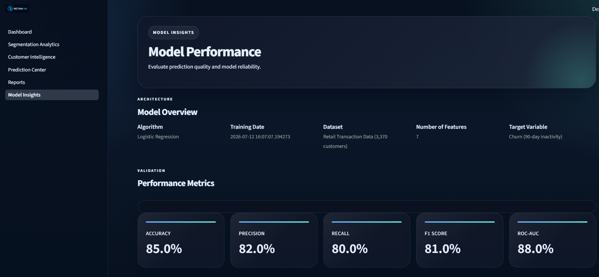
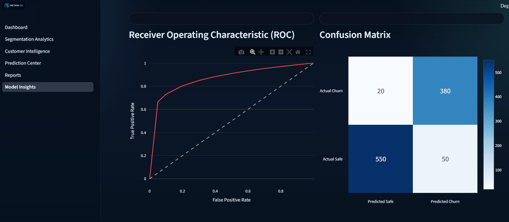
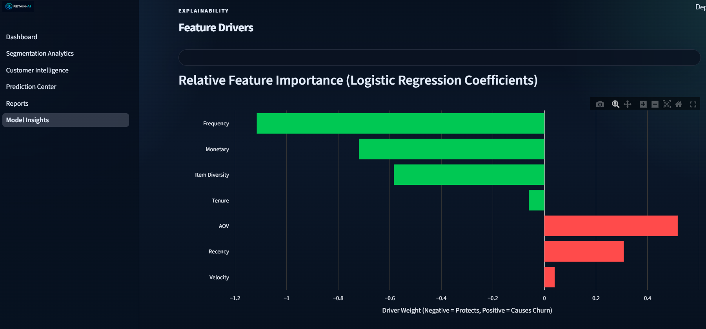

---

# 💻 Technology Stack

RetainAI is built using a modern, decoupled Python stack:

| Layer | Technology | Purpose |
| :--- | :--- | :--- |
| **Frontend** | Streamlit | Responsive web application, state synchronization, interactive UI |
| **Backend** | FastAPI | High-performance RESTful API, service routing, file ingestion |
| **Machine Learning** | Scikit-learn | Churn prediction classification and feature preprocessing |
| **CLV Modeling** | Lifetimes | BG/NBD purchase frequency and Gamma-Gamma monetary value models |
| **Data Processing** | Pandas, NumPy | Data cleaning, RFM aggregation, and feature engineering |
| **Storage & Data** | SQLite, Parquet, PyArrow | Fast local SQL queries and high-performance columnar data storage |
| **Visualization** | Plotly | Dynamic dark-theme charts, scatter matrices, and distributions |
| **Model Serialization** | Joblib | Serialization and loading of trained machine learning pipelines |
| **Validation** | Pydantic | Request and response schema validation |
| **Server** | Uvicorn | ASGI production server for FastAPI |

---

## 🧠 Machine Learning Overview

| Component | Model / Algorithm | Purpose |
| :--- | :--- | :--- |
| **Churn Prediction** | Logistic Regression | Predicts churn probability based on customer RFM and behavioral metrics. |
| **Feature Scaling** | StandardScaler | Normalizes numerical attributes prior to model inference. |
| **Customer Lifetime Value** | BG/NBD + Gamma-Gamma | Forecasts 90-day projected transaction volume and monetary value. |

---

## 📂 Dataset Information

- **Dataset:** Online Retail II Dataset
- **Domain:** E-Commerce / Retail Customer Transactions
- **Customer Base:** ~3,370 unique analyzed customer profiles
- **Transactions:** ~397,000+ validated purchase transactions
- **Core Features:** Recency, Frequency, Monetary, Tenure, Velocity, Average Order Value, Item Diversity, Predicted CLV, and Churn Risk.

---

# 📂 Project Structure

```text
retainai/
│
├── backend/                     # FastAPI backend application
│   ├── api/                     # REST API route handlers
│   │   ├── customers.py         # Customer search, filter, and 360 endpoints
│   │   ├── dashboard.py         # Executive dashboard summary & charts
│   │   ├── dataset.py           # Dataset Intelligence batch upload & analysis
│   │   ├── health.py            # Service health & keep-alive endpoint
│   │   ├── model.py             # Model performance metrics & ROC curves
│   │   ├── prediction.py        # Single-customer churn inference
│   │   └── reports.py           # CSV report generators & summaries
│   ├── config/                  # Settings and environment configuration
│   ├── database/                # SQLite connection utilities
│   ├── ml/                      # Model loader with auto-training fallback
│   ├── pipeline/                # Analytical pipeline engine
│   │   ├── analytics/           # Churn, CLV, and segmentation engines
│   │   └── preprocessing/       # Cleaning, RFM, and feature engineering
│   ├── schemas/                 # Pydantic request/response models
│   ├── services/                # Business logic and service layers
│   ├── utils/                   # Logging and helper utilities
│   └── main.py                  # FastAPI application entry point
│
├── frontend/                    # Streamlit frontend application
│   ├── assets/                  # Logos and static branding
│   ├── components/              # Reusable UI tables and metric cards
│   ├── pages/                   # Application navigation pages
│   │   ├── Customer_Intelligence.py
│   │   ├── Dashboard.py
│   │   ├── Model_Insights.py
│   │   ├── Prediction_Center.py
│   │   ├── Reports.py
│   │   └── Segmentation_Analytics.py
│   ├── utils/                   # API client and dashboard styling helpers
│   └── app.py                   # Streamlit multi-page entry point
│
├── data/
│   ├── raw/                     # Original raw transaction dataset
│   └── processed/               # Cleaned parquet datasets and feature matrices
│
├── database/
│   ├── retail.db                # SQLite database
│   └── README.md                # Database schema documentation
│
├── docs/
│   └── screenshots/             # README and presentation screenshots
│
├── models/
│   ├── churn/                   # Churn model weights and scalers
│   └── clv/                     # Persisted BG/NBD and Gamma-Gamma CLV models
│
├── notebooks/                   # End-to-end ML research and exploration notebooks
├── scripts/                     # Database generation and setup utilities
├── README.md                    # Comprehensive project documentation
├── requirements.txt             # Python dependencies
├── .env.example                 # Environment configuration template
└── .gitignore                   # Git version control ignore rules
```

### Repository Highlights

- **Modular architecture** with a clear separation between frontend, backend, and machine learning.
- **REST API-based communication** between Streamlit and FastAPI.
- **Reusable service layer** to isolate business logic from API routes.
- **Dedicated documentation** for database schema and screenshots.
- **Notebook-driven machine learning workflow** for reproducibility.

---

# 🧠 Machine Learning Pipeline

RetainAI follows a complete machine learning workflow, starting from raw transactional data and ending with an interactive customer intelligence platform.

```text
                           Online Retail II Dataset
                                      │
                                      ▼
                     Data Cleaning & Preprocessing
                 (Missing Values, Duplicates, Formatting)
                                      │
                                      ▼
                        Feature Engineering & RFM Analysis
             (Recency, Frequency, Monetary, Customer Behavior)
                                      │
                     ┌────────────────┴────────────────┐
                     ▼                                 ▼
        Customer Lifetime Value                 Churn Prediction
             (BG/NBD + Gamma-Gamma)          (Logistic Regression)
                     │                                 │
                     └────────────────┬────────────────┘
                                      ▼
                      Master Customer Feature Dataset
                                      │
                                      ▼
                           SQLite Database (retail.db)
                                      │
                                      ▼
                           FastAPI Backend Services
                                      │
                                      ▼
                         Streamlit Customer Platform
```

## Machine Learning Workflow

### 1. Data Collection
- Imported the Online Retail II dataset.
- Performed initial data validation and quality assessment.

### 2. Data Preprocessing
- Removed missing and duplicate records.
- Filtered invalid transactions.
- Standardized data types and formats.

### 3. Feature Engineering
- Generated customer-level behavioral features.
- Computed RFM (Recency, Frequency, Monetary) metrics.
- Engineered additional features including customer tenure, purchase velocity, average order value, and item diversity.

### 4. Customer Lifetime Value (CLV)
- Estimated future purchase frequency using the **BG/NBD** model.
- Estimated future monetary value using the **Gamma-Gamma** model.
- Calculated projected **90-day Customer Lifetime Value (CLV)**.

### 5. Churn Prediction
- Trained a **Logistic Regression** model.
- Applied **StandardScaler** for feature normalization.
- Generated churn probabilities and binary churn predictions.

### 6. Deployment Pipeline
- Stored engineered customer data and predictions in SQLite.
- Exposed business logic through FastAPI REST APIs.
- Delivered predictions and analytics through the Streamlit frontend.

---

# ⚙️ Installation & Setup

Follow the steps below to set up and run RetainAI on your local machine.

## 1️⃣ Clone the Repository

```bash
git clone https://github.com/abhilashreddypendyala/retainai.git
cd retainai
```

---

## 2️⃣ Create a Virtual Environment

### Windows

```bash
python -m venv .venv
.venv\Scripts\activate
```

### macOS / Linux

```bash
python3 -m venv .venv
source .venv/bin/activate
```

---

## 3️⃣ Install Dependencies

```bash
pip install -r requirements.txt
```

---

## 4️⃣ Configure Environment Variables

Create a `.env` file in the project root by copying the example file.

### Windows

```bash
copy .env.example .env
```

### macOS / Linux

```bash
cp .env.example .env
```

Update the environment variables if required.

---

## 5️⃣ Database Setup

The repository includes a ready-to-use SQLite database.

If you wish to regenerate the database from the processed datasets, run:

```bash
python scripts/create_database.py
```

---

## 6️⃣ Start the FastAPI Backend

```bash
uvicorn backend.main:app --reload
```

The backend will start at:

```
http://127.0.0.1:8000
```

API Documentation:

```
http://127.0.0.1:8000/docs
```

---

## 7️⃣ Start the Streamlit Frontend

Open another terminal and run:

```bash
streamlit run frontend/app.py
```

The application will open automatically in your browser.

Default URL:

```
http://localhost:8501
```

---

## 8️⃣ Verify the Installation

After both services are running:

- Open the Streamlit application.
- Navigate through all application modules.
- Verify that the Dashboard loads correctly.
- Test the Prediction Center with an existing customer.
- Confirm that Reports can be generated successfully.

If all pages load correctly, RetainAI has been installed successfully.

---

# 🌐 API Overview

RetainAI follows a RESTful architecture where the Streamlit frontend communicates exclusively with the FastAPI backend. All business logic, machine learning inference, and database interactions are handled through dedicated API endpoints.

## Base URL

```
http://127.0.0.1:8000
```

Interactive API documentation is available at:

```
http://127.0.0.1:8000/docs
```

---

## Available Endpoints

### 🏥 Health

| Method | Endpoint | Description |
|--------|----------|-------------|
| GET | `/health` | Verify backend availability and service health. |

---

### 📊 Dashboard

| Method | Endpoint | Description |
|--------|----------|-------------|
| GET | `/dashboard/summary` | Returns dashboard KPI metrics. |
| GET | `/dashboard/charts` | Returns data for dashboard visualizations. |
| GET | `/dashboard/interventions` | Retrieves high-value customers requiring intervention. |
| GET | `/dashboard/model-summary` | Returns model metadata displayed on the dashboard. |

---

### 👥 Customer Intelligence

| Method | Endpoint | Description |
|--------|----------|-------------|
| GET | `/customers` | Returns paginated customer records. |
| GET | `/customers/ids` | Returns a flat list of all customer IDs for frontend selectors. |
| GET | `/customers/search` | Searches customers by Customer ID. |
| GET | `/customers/filter` | Filters customers by segment, country, and churn status. |
| GET | `/customers/{customer_id}` | Returns the complete Customer 360 profile. |

---

### 🤖 Prediction Center

| Method | Endpoint | Description |
|--------|----------|-------------|
| POST | `/prediction` | Predicts customer churn probability using the trained Logistic Regression model. |

---

### 📁 Dataset Intelligence (Batch Analysis)

| Method | Endpoint | Description |
|--------|----------|-------------|
| POST | `/dataset/analyze` | Ingests a raw transaction file (CSV/Excel) and returns full batch metrics, risk scores, and segment analytics in-memory. |

---

### 🧠 Model Insights

| Method | Endpoint | Description |
|--------|----------|-------------|
| GET | `/model/insights` | Returns model evaluation metrics, feature importance, ROC data, and confusion matrix information. |

---

### 📄 Reports

| Method | Endpoint | Description |
|--------|----------|-------------|
| GET | `/reports/executive-summary` | Returns executive business summary. |
| GET | `/reports/customer-report` | Downloads the complete customer report (CSV). |
| GET | `/reports/high-risk` | Downloads the high-risk customer report (CSV). |
| GET | `/reports/segment-summary` | Downloads the customer segmentation summary (CSV). |

---

## API Design Principles

- RESTful endpoint design.
- Modular service-layer architecture.
- Request and response validation using Pydantic.
- Separation of presentation, business logic, and data access.
- JSON-based communication between frontend and backend.
- Easily extensible architecture for future APIs.

---

# 🚀 Future Roadmap

RetainAI is designed with a modular architecture that makes it easy to extend with new capabilities. The following enhancements are planned for future releases.

## 🗄️ Database & Infrastructure

- PostgreSQL integration for production environments.
- Docker containerization.
- CI/CD pipeline using GitHub Actions.

---

## 🔐 Security & User Management

- User authentication and authorization.
- Role-based access control (RBAC).
- Secure API authentication using JWT.
- Activity logging and audit trails.

---

## 🧠 Machine Learning Enhancements

- SHAP-based explainable AI visualizations.
- Automatic model retraining pipeline.
- Support for multiple ML models.
- Model versioning and comparison dashboard.
- Advanced hyperparameter optimization.

---

## 📊 Business Intelligence

- Interactive executive dashboards.
- Scheduled report generation.
- Email-based report delivery.
- Advanced customer cohort analysis.
- Revenue forecasting and trend analysis.

---

## 🌍 Platform Enhancements

- Multi-user support.
- Multi-organization (multi-tenant) architecture.
- Responsive mobile-friendly interface.
- Dark/Light theme support.
- Internationalization (multi-language support).

---

RetainAI will continue evolving as a production-ready customer intelligence platform by incorporating scalable cloud infrastructure, advanced analytics, and enterprise-grade machine learning capabilities.

---

# 👨‍💻 Author

**Abhilash Pendyala**

B.Tech Computer Science & Engineering (Artificial Intelligence)

## Connect With Me

- 💼 LinkedIn: https://www.linkedin.com/in/abhilash-reddy-pendyala-97012b306/
- 💻 GitHub: https://github.com/abhilashreddypendyala
- 📧 Email: abhilashpendyala13@gmail.com

---

If you have any suggestions, feedback, or would like to collaborate on AI and Machine Learning projects, feel free to connect!

---

## 👥 Project Team

This project was developed as a collaborative final-year academic project.

- Abhilash Pendyala
- Varun
- Gopi
- Balu

---

# 🙏 Acknowledgements

This project was developed as part of a final-year academic project with the objective of applying Machine Learning, Data Analytics, and Full-Stack Development concepts to solve real-world customer retention challenges.

## Academic Mentorship

I would like to express my sincere gratitude to **Dhaval Simaria** for providing valuable guidance, technical direction, and mentorship throughout the development of this project.

## Open Source Technologies

This project was built using several outstanding open-source technologies, including:

- FastAPI
- Streamlit
- Scikit-learn
- Lifetimes
- Pandas
- NumPy
- Plotly
- SQLite

## Dataset

Special thanks to the **Online Retail II Dataset** for providing the transactional data used for customer analytics, churn prediction, and Customer Lifetime Value (CLV) modeling.